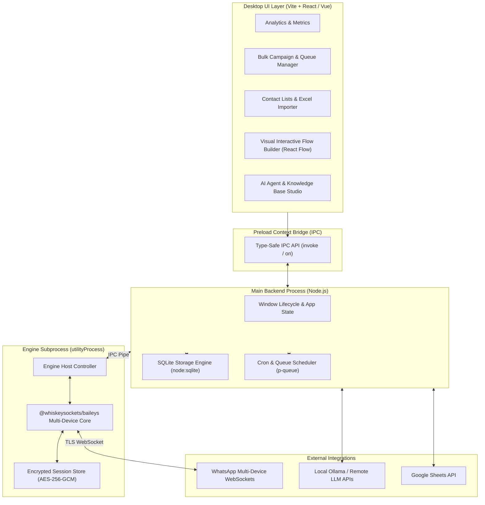
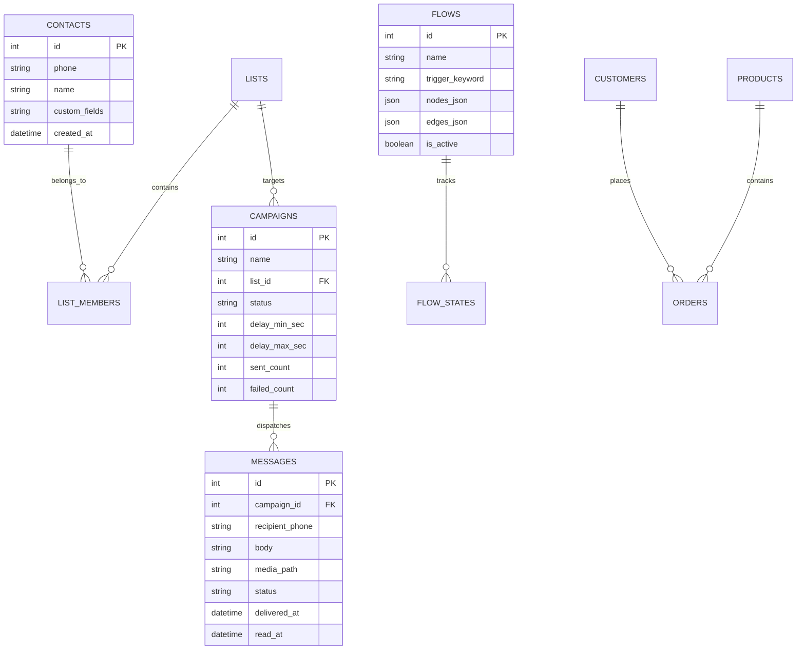
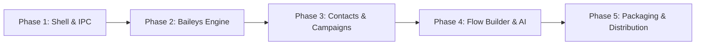

# WhatsApp Automation & CRM Platform: Technical Blueprint & Build Specification

This specification outlines the complete system design, component architecture, database schemas, and implementation roadmap required to build an independent, fully-featured desktop WhatsApp CRM and automation application from scratch without commercial license locks.

---

## 1. System Architecture Overview

The application follows an isolated multi-process desktop architecture using Electron or Tauri, ensuring high reliability, non-blocking UI responsiveness, and crash-resilient socket management.



---

## 2. Technology Stack Selection

| Component | Recommended Technology | Purpose |
| :--- | :--- | :--- |
| **Desktop Shell** | Electron 34+ or Tauri 2.0 | Cross-platform desktop runtime with secure IPC. |
| **WhatsApp Engine** | `@whiskeysockets/baileys` (v7.x) | Native WebSocket client for WhatsApp multi-device protocol. |
| **Database** | Embedded SQLite (`node:sqlite` or `better-sqlite3`) | Fast, local-first storage with zero external database dependencies. |
| **Frontend Framework**| React 19 / Vue 3 + Tailwind CSS | Reactive, responsive desktop interface. |
| **Visual Flow Builder**| `@xyflow/react` (React Flow) | Node-based visual interface for building chat branching logic. |
| **Parsing & Data** | `read-excel-file`, `papaparse`, `libphonenumber-js` | Contact import, phone formatting, and validation. |
| **AI Integration** | Ollama (Local) + OpenAI/Anthropic/Gemini SDKs | Retrieval-augmented generation (RAG) and customer query responses. |

---

## 3. Core Database Schemas (`schema.sql`)

The application requires three primary logical data groups: CRM/Campaigns, Automation/Flows, and AI Knowledge Base.



### Complete Schema DDL

```sql
-- 1. Contacts & Segmentation
CREATE TABLE IF NOT EXISTS contacts (
    id INTEGER PRIMARY KEY AUTOINCREMENT,
    phone TEXT NOT NULL UNIQUE,
    name TEXT,
    notes TEXT,
    created_at DATETIME DEFAULT CURRENT_TIMESTAMP
);

CREATE TABLE IF NOT EXISTS lists (
    id INTEGER PRIMARY KEY AUTOINCREMENT,
    name TEXT NOT NULL,
    created_at DATETIME DEFAULT CURRENT_TIMESTAMP
);

CREATE TABLE IF NOT EXISTS list_members (
    list_id INTEGER NOT NULL REFERENCES lists(id) ON DELETE CASCADE,
    contact_id INTEGER NOT NULL REFERENCES contacts(id) ON DELETE CASCADE,
    PRIMARY KEY (list_id, contact_id)
);

-- 2. Bulk Campaigns & Queue
CREATE TABLE IF NOT EXISTS campaigns (
    id INTEGER PRIMARY KEY AUTOINCREMENT,
    name TEXT NOT NULL,
    list_id INTEGER REFERENCES lists(id),
    template_text TEXT NOT NULL,
    media_path TEXT,
    delay_min_seconds INTEGER DEFAULT 10,
    delay_max_seconds INTEGER DEFAULT 25,
    status TEXT DEFAULT 'pending', -- pending, running, paused, completed, cancelled
    total_recipients INTEGER DEFAULT 0,
    created_at DATETIME DEFAULT CURRENT_TIMESTAMP
);

CREATE TABLE IF NOT EXISTS messages (
    id INTEGER PRIMARY KEY AUTOINCREMENT,
    campaign_id INTEGER REFERENCES campaigns(id) ON DELETE CASCADE,
    session_id TEXT NOT NULL,
    recipient_phone TEXT NOT NULL,
    message_text TEXT NOT NULL,
    media_url TEXT,
    status TEXT DEFAULT 'queued', -- queued, sent, delivered, read, failed
    whatsapp_message_id TEXT,
    error_message TEXT,
    sent_at DATETIME
);

-- 3. Visual Automation Flows
CREATE TABLE IF NOT EXISTS flows (
    id INTEGER PRIMARY KEY AUTOINCREMENT,
    name TEXT NOT NULL,
    trigger_keyword TEXT,
    is_fallback BOOLEAN DEFAULT 0,
    nodes_graph TEXT NOT NULL, -- JSON formatted React Flow nodes
    edges_graph TEXT NOT NULL, -- JSON formatted React Flow edges
    is_active BOOLEAN DEFAULT 1
);

CREATE TABLE IF NOT EXISTS flow_sessions (
    chat_jid TEXT PRIMARY KEY,
    active_flow_id INTEGER REFERENCES flows(id),
    current_node_id TEXT,
    variables_json TEXT,
    last_interaction DATETIME DEFAULT CURRENT_TIMESTAMP
);

-- 4. AI Knowledge Base & Products
CREATE TABLE IF NOT EXISTS knowledge_items (
    id INTEGER PRIMARY KEY AUTOINCREMENT,
    title TEXT NOT NULL,
    content TEXT NOT NULL,
    tags TEXT
);

CREATE TABLE IF NOT EXISTS products (
    id INTEGER PRIMARY KEY AUTOINCREMENT,
    sku TEXT UNIQUE,
    title TEXT NOT NULL,
    price REAL NOT NULL,
    description TEXT,
    image_path TEXT,
    in_stock BOOLEAN DEFAULT 1
);
```

---

## 4. Subsystem Implementations

### A. WhatsApp Engine Subprocess (`engineHost.js`)
Isolates socket operations using `utilityProcess.fork()`:

```javascript
import makeWASocket, {
    useMultiFileAuthState,
    DisconnectReason,
    fetchLatestWaWebVersion,
    Browsers
} from '@whiskeysockets/baileys';
import pino from 'pino';

class EngineSession {
    constructor(sessionId, authDir) {
        this.sessionId = sessionId;
        this.authDir = authDir;
        this.sock = null;
    }

    async start() {
        const { state, saveCreds } = await useMultiFileAuthState(this.authDir);
        const { version } = await fetchLatestWaWebVersion().catch(() => ({ version: [2, 3000, 1015901307] }));

        this.sock = makeWASocket({
            version,
            auth: state,
            logger: pino({ level: 'silent' }),
            browser: Browsers.windows('Desktop'),
            markOnlineOnConnect: false
        });

        this.sock.ev.on('creds.update', saveCreds);

        this.sock.ev.on('connection.update', (update) => {
            const { connection, lastDisconnect, qr } = update;
            if (qr) {
                process.parentPort.postMessage({ type: 'qr', sessionId: this.sessionId, qr });
            }
            if (connection === 'open') {
                process.parentPort.postMessage({ type: 'status', sessionId: this.sessionId, status: 'open' });
            }
            if (connection === 'close') {
                const shouldReconnect = lastDisconnect?.error?.output?.statusCode !== DisconnectReason.loggedOut;
                if (shouldReconnect) this.start();
            }
        });

        this.sock.ev.on('messages.upsert', async ({ messages, type }) => {
            if (type !== 'notify') return;
            for (const msg of messages) {
                if (msg.key.fromMe) continue;
                process.parentPort.postMessage({
                    type: 'incoming_message',
                    sessionId: this.sessionId,
                    from: msg.key.remoteJid,
                    text: msg.message?.conversation || msg.message?.extendedTextMessage?.text || ''
                });
            }
        });
    }

    async sendText(toPhone, message) {
        const jid = `${toPhone.replace(/\D/g, '')}@s.whatsapp.net`;
        return await this.sock.sendMessage(jid, { text: message });
    }
}
```

---

### B. Anti-Ban & Rate-Limiting Dispatcher
To prevent account restrictions, campaign messages must use jittered timing, randomized Spintax text, and round-robin multi-account rotation.

```javascript
import PQueue from 'p-queue';

export class CampaignDispatcher {
    constructor(engineHost, options = {}) {
        this.engineHost = engineHost;
        this.minDelayMs = options.minDelayMs || 10000;
        this.maxDelayMs = options.maxDelayMs || 25000;
        this.queue = new PQueue({ concurrency: 1 });
    }

    // Resolves Spintax format: "{Hello|Hi|Greetings} {Friend|Customer}"
    parseSpintax(text) {
        return text.replace(/\{([^{}]+)\}/g, (match, choices) => {
            const options = choices.split('|');
            return options[Math.floor(Math.random() * options.length)];
        });
    }

    getRandomDelay() {
        return Math.floor(Math.random() * (this.maxDelayMs - this.minDelayMs + 1)) + this.minDelayMs;
    }

    enqueueMessage(sessionId, recipient, rawTemplate) {
        return this.queue.add(async () => {
            const finalBody = this.parseSpintax(rawTemplate);
            await this.engineHost.sendText(sessionId, recipient, finalBody);
            
            // Jitter delay before unlocking next message
            const waitTime = this.getRandomDelay();
            await new Promise(resolve => setTimeout(resolve, waitTime));
        });
    }
}
```

---

### C. Visual Flow Execution Engine
Executes stateful branching dialogue when incoming messages match trigger conditions:

```javascript
export class FlowEngine {
    constructor(db) {
        this.db = db;
    }

    async processIncoming(fromJid, messageText) {
        let state = this.getChatState(fromJid);

        if (!state) {
            // Check triggers for root node
            const flow = this.findMatchingFlow(messageText);
            if (!flow) return null;
            state = { flowId: flow.id, currentNode: flow.startNodeId, variables: {} };
        }

        const flow = this.getFlow(state.flowId);
        const node = flow.nodes.find(n => n.id === state.currentNode);

        let reply = '';
        if (node.type === 'message') {
            reply = node.data.content;
            state.currentNode = this.getNextNode(flow, node.id, messageText);
        } else if (node.type === 'menu') {
            const option = node.data.options.find(opt => opt.key === messageText.trim());
            if (option) {
                state.currentNode = option.targetNodeId;
                const nextNode = flow.nodes.find(n => n.id === state.currentNode);
                reply = nextNode.data.content;
            } else {
                reply = "Invalid choice. Please select from the listed options.";
            }
        }

        this.saveChatState(fromJid, state);
        return reply;
    }
}
```

---

## 5. Group Grabber & LID-to-Phone Resolver
WhatsApp groups often expose Linked Identity (`@lid`) addresses instead of explicit phone numbers. Baileys provides an internal Signal key store to map these identifiers back to actual phone numbers:

```javascript
export async function extractGroupMembers(sock, groupJid) {
    const metadata = await sock.groupMetadata(groupJid);
    const lidList = [];
    const memberResults = [];

    for (const participant of metadata.participants) {
        if (participant.id.endsWith('@s.whatsapp.net')) {
            memberResults.push({
                phone: participant.id.split('@')[0],
                isAdmin: !!participant.admin
            });
        } else if (participant.id.endsWith('@lid')) {
            lidList.push(participant.id);
        }
    }

    // Resolve LIDs using Signal Repository cache
    if (lidList.length > 0 && sock.signalRepository?.lidMapping) {
        const mappings = await sock.signalRepository.lidMapping.getPNsForLIDs(lidList).catch(() => []);
        for (const item of mappings) {
            memberResults.push({
                phone: item.pn.split('@')[0],
                isAdmin: false
            });
        }
    }

    return memberResults;
}
```

---

## 6. Implementation Roadmap



1. **Phase 1: Core Shell & Storage Setup**
   - Initialize Electron / Vite boilerplate with TypeScript.
   - Set up SQLite schema using `node:sqlite`.
   - Implement preload script and type-safe IPC channels.

2. **Phase 2: Engine Isolation Subprocess**
   - Build `engineHost.js` using Electron `utilityProcess`.
   - Wire multi-account session folder creation and QR code broadcasting to UI.
   - Implement reconnection backoff routines.

3. **Phase 3: CRM Contacts & Campaign Queue**
   - Build Excel/CSV import parser with field mapping.
   - Integrate phone number validation via `libphonenumber-js`.
   - Implement `CampaignDispatcher` with Spintax and anti-ban delay jitter.

4. **Phase 4: Chatbot, Flows & Knowledge Base**
   - Integrate `@xyflow/react` for visual canvas editor.
   - Connect flow executor to incoming messages.
   - Implement local Ollama fallback for knowledge base querying.

5. **Phase 5: Native Packaging**
   - Configure `electron-builder` to bundle platform binaries.
   - Enable auto-updates using generic GitHub or S3 endpoints.
